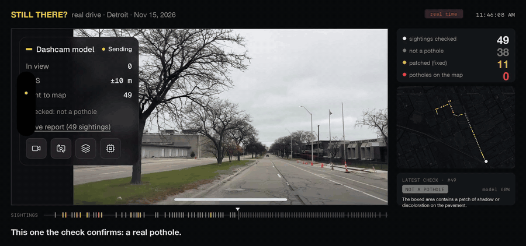

# Still There?



**The city closes pothole reports in days. We check whether they actually got fixed.**

Still There? takes Detroit's public pothole reports, checks the road with a phone or dash cam,
and shows each pothole's history on one map: reported, closed, and then still there or fixed.

## Live Demo

- Map: https://wayneawshackathon.vercel.app/
- Phone camera page: https://wayneawshackathon.vercel.app/live
- Repair request: open any pin on the map and choose "Evidence report and PDF"

## How It Works

1. **City data.** We pull pothole reports from Improve Detroit and group reports within 50 m into one pothole.
2. **Detection.** A small pothole model runs in the browser on a phone or dash cam, so it keeps up with a moving car.
3. **Second check.** A larger vision model reviews each hit and decides pothole, patch, or shadow, with a one-line reason.
4. **Map and report.** Confirmed potholes appear on the map, and each one can be turned into a repair request for the road owner.

## Team

| Role | Person | GitHub | Folders |
|---|---|---|---|
| Backend, database, map | Ayaan | [@ayaanamir](https://github.com/ayaanamir) | `api/`, `services/api/`, `apps/map/` |
| Drive footage and model training | Muq | [@MuqC](https://github.com/MuqC) | `pipeline/` |
| Phone page and pitch | Ado | [@ado11231](https://github.com/ado11231) | `apps/live/`, `pitch/` |

## Tech Stack

- Pothole model: YOLO11, run in the browser with ONNX Runtime Web
- Vision check: OpenRouter
- Hosting and API: Vercel
- Database: Neon Postgres
- Images: Cloudflare R2
- Map: Leaflet
- City data: Improve Detroit open data

## Project Layout

```
api/            REST API (Vercel Functions)
apps/live/      phone camera page
apps/map/       map, repair request, and labeling pages
services/api/   database schema and city data import
pipeline/       drive footage processing and model training
pitch/          pitch script, demo plan, demo video tools
shared/         data contracts and sample data
docs/           team workflow and requests
```

## Run It Locally

1. Copy `.env.example` to `.env` and fill in the values. Never commit `.env`.
2. Install packages: `npm install`
3. Start the site and API: `npx vercel dev`
4. Open `http://localhost:3000` for the map and `http://localhost:3000/live` for the phone page.

The data shapes every part of the project shares are in `shared/CONTRACTS.md`.

## Team Workflow

- Tasks live on the [project board](https://github.com/ayaanamir/RoadMapWayneAWSHackathon/issues). See it with `python3 scripts/board.py`.
- Claim a task before starting: `python3 scripts/board.py claim <#> "<you>/<agent>"`
- Team chat is [issue #1](https://github.com/ayaanamir/RoadMapWayneAWSHackathon/issues/1). Read it with `python3 scripts/chat.py read`.
- Rules for working in this repo are in `AGENTS.md` and `docs/WORKFLOW.md`.

## Timeline

| When | Goal |
|---|---|
| Sat 6:00 PM | Map shows real city reports with timelines |
| Sat midnight | First drive clip processed onto a pin |
| Sun 8:00 AM | Feature freeze, bug fixes and backup video only |
| Sun 11:30 AM | Submitted on Shipyard (deadline 12:00) |
